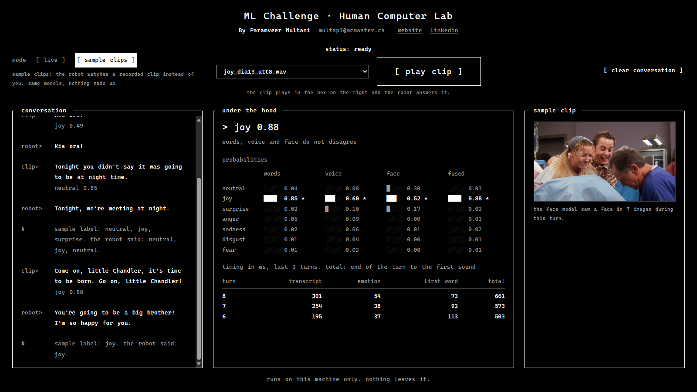
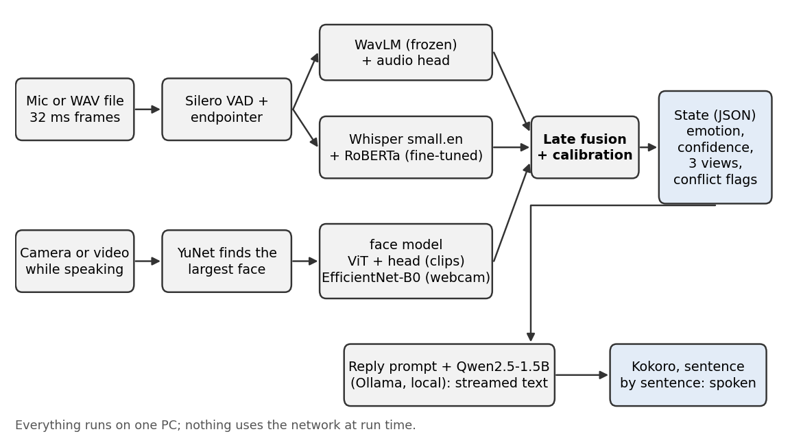
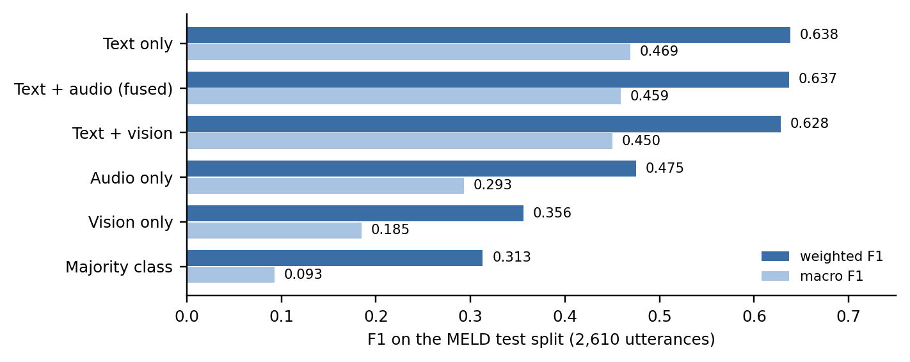

<div align="center">

# Human Computer Lab ML Challenge

**A companion robot that hears what you say, how you say it, and the look on your face,<br>and answers out loud in under a second.**


<a href="#demo-video"></a>
&nbsp;
<a href="REPORT.docx"></a>

[Decision log](DECISIONS.md) · [Quick start](#quick-start)



| **0.28 s** | **0.58 s** | **0.638** | **2.18 B** |
| :---: | :---: | :---: | :---: |
| emotion ready after you stop | robot starts speaking | weighted F1 on MELD test | parameters, all local |

</div>

## Demo video

**[Watch the demo (5.5 minutes)](docs/demo.mp4)**: the video is in the repository at `docs/demo.mp4` (10 MB). On the file's page, click **View raw** to play or download it.

The full write-up (decisions, results, problems, limitations, next steps) is in the **[report (Word)](REPORT.docx)**, with the same text in [REPORT.md](REPORT.md).

What it shows:
- **Live mode:** talking to the robot with the webcam on, while each model's view, the fused emotion, and the timings update.
- **Three inputs together:** a happy sentence said with an angry voice and face, and the robot noticing.
- **Interrupting:** talking over the robot to cut it off.
- **Sample clips:** real MELD clips through the same models, with the true label shown next to what the robot said.
- **One input to both outputs:** the replay script printing the structured state and the spoken reply.

## How it works

<p align="center"></p>

When the voice or the face contradicts the words (a happy sentence said angrily), the robot notices and checks in instead of guessing.

<details>
<summary>Example output for one turn</summary>

```json
{
  "transcript": "What?",
  "emotion": {"label": "surprise", "confidence": 0.56},
  "views": {"text": "surprise 0.67", "audio": "surprise 0.47", "vision": "neutral 0.31"},
  "tone_text_conflict": false,
  "face_text_conflict": false,
  "latency_ms": {"endpoint": 608, "asr": 370, "audio": 333, "text": 12, "state": 386}
}
```

</details>

## Results

<p align="center"></p>

- Text carries most of the signal. Adding the voice helped on dev but not on test, and the report says why.
- The voice and the face earn their place live: they catch a happy sentence said angrily.
- The test split was scored once, by one script, after every choice was made on dev.

Latency, memory, limitations, and next steps are in the [report](REPORT.docx).

## Quick start

**You need:** Windows 10 or 11, Python 3.11, [Ollama](https://ollama.com/download), and a microphone and speakers. A webcam and an NVIDIA GPU (6 GB) are recommended; without a GPU it runs on the CPU, just slower.

**1. Install** (about 15 minutes, no dataset or training needed)

```powershell
git clone https://github.com/paramveer30/HCL-ML-Challenge.git
cd HCL-ML-Challenge
py -3.11 -m venv .venv
.venv\Scripts\activate
pip install torch==2.14.1 --index-url https://download.pytorch.org/whl/cu126
pip install -r requirements.txt
pip install -e .
python -m spacy download en_core_web_sm
```

**2. Download the models** (once; after this nothing uses the network)

```powershell
python scripts/fetch_models.py
ollama pull qwen2.5:1.5b
```

This fetches the pretrained models and my trained models and sample clips from the `v1.0` release. While the repository is private, run `gh auth login` first, or download the two zips from Releases and pass them with `--zip`.

**3. Run**

```powershell
python -m uvicorn ui.server:app --host 127.0.0.1 --port 8000
```

Open **http://127.0.0.1:8000**, and allow the camera and microphone.

- **Live** (default): hold the space bar, talk, and let go.
- **Sample clips**: play a real MELD clip and compare the true label with what the robot said.

<details>
<summary>Run from the terminal</summary>

Replay a clip through the whole system:

```powershell
python scripts/replay.py ui/clips/joy_dia13_utt8.wav --video ui/clips/joy_dia13_utt8.mp4 --label joy
```

```
You:    Come on, little Chandler, it's time to be born. Go on, little Chandler!
Feels:  joy 88%  (words: joy 85%, voice: joy 60%, face: joy 52%)
Robot:  You're talking about me? I'm not little Chandler, I'm a robot.
Timing: state 463 ms, first word 539 ms, full reply 678 ms  (after 608 ms of silence)
```

Options:
- `--json` prints the full state.
- `--no-voice` gives the reply as text only.
- `--fast` skips the real-time pacing.

To talk to it with the microphone instead, run `python scripts/live.py`.

</details>

<details>
<summary>Troubleshooting</summary>

- **No sound, or it doesn't hear you:** run `python scripts/check_audio.py`, then set `pipeline.input_device` and `voice.output_device` in `configs/default.yaml`.
- **The page says something is missing:** make sure Ollama is running and `fetch_models.py` finished.
- **No webcam:** it still works from words and voice. `pipeline.use_vision: false` turns the face models off.
- **Tests:** `pytest` runs 206 tests on the CPU in about 15 s, with no dataset or models.

</details>

<details>
<summary>Retrain from scratch (optional, about an hour)</summary>

Download `MELD.Raw.tar.gz` (10.9 GB) from [declare-lab/MELD](https://github.com/declare-lab/MELD) and unpack it. Point the data paths in `configs/default.yaml` at it, and put [ffmpeg](https://ffmpeg.org/) on the PATH. Then run:

```powershell
python -m meldrt.data.extract_audio      # mp4 to 16 kHz WAV
python -m meldrt.train.cache_audio       # WavLM features
python -m meldrt.train.train_text        # fine-tune RoBERTa
python -m meldrt.train.train_audio       # audio head
python -m meldrt.train.tune_fusion       # text/audio weight on dev
python -m meldrt.train.cache_vision      # face features
python -m meldrt.train.train_vision      # vision head
python -m meldrt.train.tune_fusion3      # three-model weights on dev
python -m meldrt.train.calibrate         # confidence on dev
python scripts/make_samples.py           # sample clips
python scripts/final_eval.py             # the test run
python scripts/bench_latency.py          # latency and memory
python scripts/count_params.py           # parameter count, fails above 6 B
```

</details>

<details>
<summary>Project layout</summary>

```
configs/default.yaml   every path, threshold, and model name
src/meldrt/
  data/                MELD loading, text cleanup, audio and video extraction
  models/              features, the shared head, fusion, calibration
  train/               caching, training, tuning on dev
  eval/                metrics and parameter counting
  pipeline/            voice detection, speech recognition, turn loop, reply, voice
scripts/               replay, live, evaluation, benchmarks, model download
ui/                    the local web page
tests/                 206 CPU tests, no data needed
```

</details>

---

<div align="center">

Built by **Paramveer Multani** · [paramveermultani.com](https://www.paramveermultani.com) · [LinkedIn](https://www.linkedin.com/in/paramveermt) · multap1@mcmaster.ca

</div>
