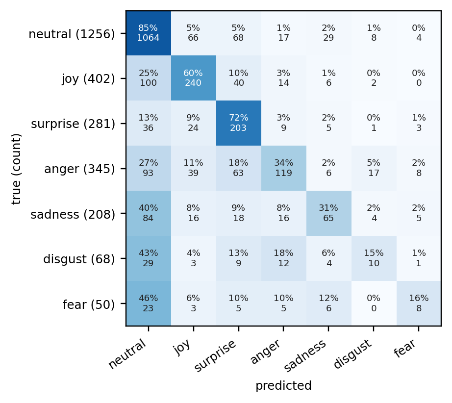

# Human Computer Lab ML Challenge: report

**Demo video:** `docs/demo.mp4` in the repository (5.5 minutes): live mode with the webcam, the three inputs disagreeing, interrupting the robot, sample MELD clips, and one input travelling to both outputs.

Track: Text + Audio, plus the optional vision extension. Every number here came from a script in this repository, run on the machine in section 6. The full log of decisions and measurements, including what did not work, is in `DECISIONS.md`.

## 1. Problem and approach

A character robot should respond to how a person feels, not only to what they said: "great." said flatly after bad news is not "great!" said with a smile. For every spoken turn the system decides which of MELD's seven emotions fits best from the words, the voice, and (with a camera) the face. It outputs a structured state (the emotion, its confidence, each model's own view, and flags when they disagree) and a short reply that streams as text and is spoken aloud. Everything runs locally on one PC.

I chose Text + Audio because every MELD utterance has one audio stream that belongs to the speaker, while the video often shows several people or the listener. Once that worked, I added vision as the optional third input.

## 2. What "real-time" means here

A conversation with a robot happens in turns: the person speaks, pauses, and expects an answer about as fast as a person would give one. So real-time means audio is processed as it arrives in 32 ms frames, a turn ends after 600 ms of silence, and the state and the start of the reply follow within a fraction of a second. Assumptions: one speaker, close to the microphone, English, turns of at most 15 s, no reaction mid-sentence. On the web page the person holds a button to talk instead, so the turn ends on release.

Milliseconds after the turn is judged over, 50 replayed turns with the face model on (`scripts/bench_latency.py`):

| | Target (p50) | p50 | p95 |
| --- | ---: | ---: | ---: |
| State ready | 600 | 279 | 516 |
| First reply token | 1,500 | 352 | 635 |
| Full reply | 3,000 | 497 | 834 |
| First spoken sound | 2,000 | 582 | 844 |

All targets are met with room to spare. Speech recognition is the largest single cost (241 ms p50). The 608 ms silence wait comes before these numbers, so from the end of speech to the first sound is about 1.2 s.

## 3. System

The voice detector and endpointer cut the audio into turns. When a turn ends, the audio model runs first (frozen WavLM averaged over time, then my small head), then Whisper turns the speech into words and RoBERTa reads them with the last two turns as context. Camera pictures are processed while the person is still speaking, so the face costs nothing after the turn. Late fusion averages the probabilities (live: words 0.25, voice 0.30, face 0.45), and a temperature fitted on dev makes the confidence match how often the label is right. When the views disagree, or the confidence is under 0.5, the reply prompt tells the robot what each input suggests and asks it to check in instead of assuming a feeling. The reply streams from Qwen2.5-1.5B and is spoken one sentence at a time.

Learned parameters on the inference path, counted from the loaded models by `scripts/count_params.py`:

| Component | Parameters |
| --- | ---: |
| Qwen2.5-1.5B-Instruct (reply, 4-bit in Ollama, counted at full size) | 1,543,714,304 |
| Whisper small.en (speech recognition) | 241,761,792 |
| RoBERTa-base, fine-tuned (text emotion) | 124,651,015 |
| WavLM-base-plus, frozen (audio features) | 94,381,936 |
| ViT-base, frozen (face features) | 85,798,656 |
| Kokoro-82M with voice and spaCy front end (speech output) | 83,511,096 |
| EfficientNet-B0 (webcam expressions) | 3,996,789 |
| Audio head, vision head, Silero VAD, YuNet face detector | 913,067 |
| **Total** | **2,178,728,655 (36.3% of the 6 billion cap)** |

## 4. Data and training

MELD has 9,989 / 1,109 / 2,610 utterances in train / dev / test; neutral is 47% of train, while fear and disgust have under 300 each. I fixed apostrophes stored as control characters in the CSVs, extracted 16 kHz mono audio with ffmpeg (capped at 15 s, like a live turn), and cached WavLM features once so the audio head trains in 25 s. Clips of 0.3 s or less (about 2%) get no audio features and use text alone. Both models use class weights $w_c \propto 1/\sqrt{n_c}$, which beat no weights and full inverse frequency on dev. Every choice (best epoch, fusion weights, temperature) was made on dev; only `scripts/final_eval.py` reads test.

## 5. Results

| Model | Dev weighted / macro F1 | Test weighted / macro F1 |
| --- | ---: | ---: |
| Majority class | 0.252 / 0.085 | 0.313 / 0.093 |
| Text only | 0.615 / 0.479 | 0.638 / 0.469 |
| Audio only | 0.500 / 0.358 | 0.475 / 0.293 |
| Text + audio (alpha 0.45) | 0.635 / 0.495 | 0.637 / 0.459 |
| Vision only | 0.345 / 0.207 | 0.356 / 0.185 |
| Text + audio + vision (0.45 / 0.55 / 0.00) | 0.635 / 0.495 | 0.637 / 0.459 |

- **Text is the strong model, and rare emotions are weak.** Both models beat the baseline by a wide margin, but fear and disgust are around 0.2 F1, and most of their mistakes go to neutral (Figure 4).
- **Fusion did not carry over to test.** It gained 0.020 weighted F1 on dev (95% interval +0.002 to +0.037) and lost 0.0015 on test. The weight came from a nearly flat curve on 1,109 rows. I did not retune after reading test. The voice stays because it lets the robot notice when tone and words disagree.
- **The face counts live, by my choice.** The pure dev search gave the face weight 0 (the scored row above): on MELD the largest face is often not the speaker, and the label belongs to the sentence, not the expression. That left the words in charge even when my voice and face clearly said otherwise. So the live system uses words 0.25, voice 0.30, face 0.45: how someone sounds and looks outweighs what they say, which is how I want a companion robot to behave. I chose this split by testing it live on webcam turns. On MELD it costs accuracy: 0.599 / 0.437 on dev against 0.635 / 0.495 for the dev-best weights, because MELD's faces are TV shots where the largest face is often not the speaker. When voice and face agree against the words (150 dev turns) it follows them on 95. Its temperature is refitted on dev (0.50, calibration error 0.026). The test rows above keep the dev-best weights; this mix was not scored on test.
- **Disagreement is still flagged.** When the face or the voice disagrees with the words, the page names it and the robot checks in instead of assuming a feeling.
- **Confidence is calibrated.** Averaging a sharp text model with a flat audio one made the shown confidence too low (0.51 average while right 66% of the time). A temperature of 0.70 fixes the number without changing any label.
- **The live path is less accurate than these scores.** On 200 dev clips, weighted F1 drops from 0.658 offline to 0.523 live, mostly because Whisper's words differ from the transcript (29% word error rate on TV audio).

## 6. Hardware and resources

| | |
| --- | --- |
| Machine | Windows 11, NVIDIA GTX 1660 Ti (6 GB), AMD Ryzen 5 5500 (6 cores), 16 GB RAM |
| GPU memory at peak | 4,788 MiB of 6,144, of which 975 belonged to other programs |
| RAM at peak | 2,378 MiB (the Python process plus Ollama) |
| Training | text model 503 s; audio head 25 s; vision head 25 s; feature caching about 35 min |
| Precision | PyTorch in fp32 (the 1660 has known half-precision problems); Whisper int8 weights; reply model 4-bit |

## 7. Decisions and trade-offs

- **Frozen WavLM with cached features.** Fine-tuning a speech encoder did not fit in 6 GB next to everything else. Caching made the audio head cheap to train and compare, at the cost of accuracy (0.475 on test).
- **Late fusion with one weight, plus disagreement flags.** Easy to tune on a small dev set and easy to explain, but it cannot learn "happy words, angry voice", so that case is flagged rather than learned.
- **600 ms of silence ends a turn.** Shorter waits cut more sentences in two (11.5% of dev clips at 600 ms, 14.2% at 500 ms), so every reply pays 608 ms.
- **A 1.5B reply model.** A 3B model replied more naturally but did not fit on the card next to the other models: speech recognition time tripled and the first sound took 1.15 s.
- **One script reads test.** Test was read once for the text and audio rows and once more for the vision rows, with everything fixed on dev first. The earlier rows came out identical.

## 8. Problems I ran into

- The benchmark slowed down what it measured: reading GPU memory from a second thread pushed the state time from 576 ms to 1,147 ms. Memory is now read between turns.
- On one GPU, speech recognition and the audio model were slower side by side than one after the other. The GPU also slowed down while idle during speech (207 ms after 1 s, 421 ms after 4 s), so it now does a little throwaway work while waiting for the turn to end. Together these took the state from 596 to 253 ms.
- Whisper writes "you" on silence. Turns that Whisper itself scores as probably not speech are dropped.
- The first webcam expression model called neutral and sad faces joy. A model trained on everyday photos (AffectNet) halved those mistakes.
- The small reply model kept saying "How can I help you?". Telling it not to made it say such phrases more (6 of 16 scripted turns); stopping generation where one begins brought it to 1 of 16.
- Caching face features ran out of RAM at clip 7,500. The script now works in batches.

## 9. Limitations

- Fusion is no more accurate than text alone on test; fear and disgust are weak; one seed only.
- MELD is acted TV audio with laugh tracks and little sarcasm, so it cannot say what the right label is for mixed signals.
- Pauses over 600 ms split a sentence into two turns. The terminal script ignores the microphone while the robot speaks. On the page, talking again cuts the robot off.
- The live webcam and the reply quality are not scored: I have no labelled webcam data and did not rate replies.
- Speed was only measured on the GTX 1660 Ti. Without an NVIDIA GPU everything runs on the CPU, more slowly.

## 10. Completed and intentionally left out

Completed: the text and audio models, late fusion, and the test ablation; the streaming turn pipeline with a structured state, streamed reply, and spoken reply; replay and live scripts; a local web page with a live mode (microphone and webcam) and a sample-clip mode; the vision extension scored on test; calibrated confidence; latency, memory, and parameter measurements; a setup that downloads my trained models, so the system runs without the dataset or training.

Left out on purpose: reinforcement learning; active-speaker detection; automatic barge-in; a learned fusion model; multiple seeds; rating reply quality; a larger reply model.

## 11. Next steps

1. Fine-tune the text model on Whisper's transcripts, since recognition errors cost the most live accuracy.
2. Fine-tune the top WavLM layers and pool over time with attention instead of averaging.
3. Record a small labelled webcam set, including sarcasm, to tune the live weights on real webcam data instead of MELD.
4. Run several seeds, and train a learned fusion on out-of-fold predictions.
5. Add automatic barge-in with echo cancellation, and an end-of-turn decision that uses the words as well as the silence.

## 12. External components

| Component | Used for | License |
| --- | --- | --- |
| MELD (declare-lab) | training and evaluation data | GPL-3.0 |
| RoBERTa-base | text model starting point | MIT |
| WavLM-base-plus (Microsoft) | audio features | MIT (code in Microsoft's `unilm` repository; the model card names no license) |
| Silero VAD | voice activity detection | MIT |
| Whisper small.en via faster-whisper | speech recognition | MIT |
| Qwen2.5-1.5B-Instruct via Ollama | reply generation | Apache 2.0 |
| Kokoro-82M | speech output | Apache 2.0 |
| `trpakov/vit-face-expression` | face features | Apache 2.0 |
| HSEmotion `enet_b0_8_best_vgaf` via ONNX Runtime | webcam expressions | Apache 2.0 |
| YuNet via OpenCV | face detection | MIT / Apache 2.0 |
| PyTorch, transformers, scikit-learn, pandas, NumPy, FastAPI | training, evaluation, web page | BSD / Apache 2.0 / MIT |

Versions are pinned in `requirements.txt`.

Development tools: an AI-assisted coding tool (Claude Code) was used for parts of the code, the web page, and the write-up. I reviewed, ran, and tested all of it, and every number in this report comes from the scripts in this repository.

## 13. Time spent

Approximate, from session notes:

| Day | Hours | What |
| --- | ---: | --- |
| Oct 1 | about 2 | plan: track, targets, architecture |
| Oct 12 | about 4 | data, text and audio models, fusion, test, the live pipeline |
| Oct 13 to 14 | about 18 | live fixes, speed, web page, vision, calibration, replies, report |
| **Total** | **about 24** | within the two to three days the brief allows |
